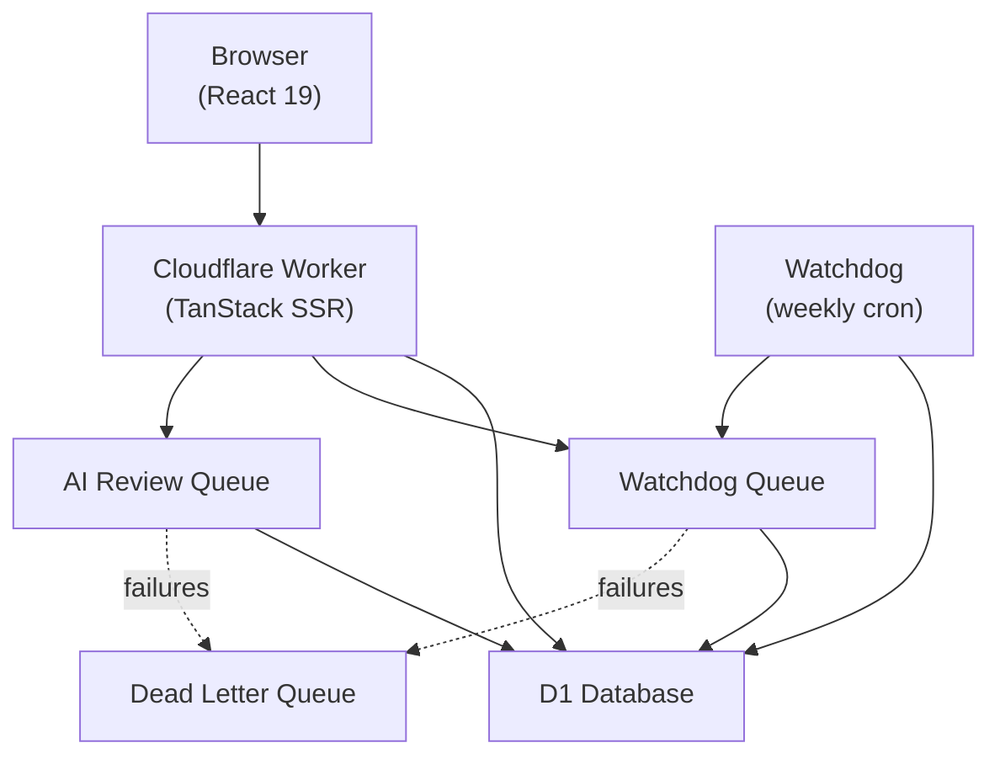

# PrivacyGPT

**Find out what an AI company does with your chats before you sign up — without reading its privacy policy.**

**Status:** actively maintained, pre-1.0. One maintainer, no tagged releases, and 14 of the 39 company rows are still awaiting review.

[](https://privacygpt.lynicis.dev)
[](https://github.com/lynicis/privacygpt/actions/workflows/ci-cd.yml)
[](LICENSE)

PrivacyGPT scores 39 AI companies — OpenAI, Anthropic, Google, Meta, Microsoft, Mistral, DeepSeek, and 32 more — on six questions that decide what happens to a conversation you paste in. Open [privacygpt.lynicis.dev](https://privacygpt.lynicis.dev), filter and compare companies, or reweight the categories so the score matches what you actually care about.

## What it answers

| Question | Default weight | What is recorded per company |
| --- | --- | --- |
| Training data | 30% | Does it train on your conversations by default? |
| Opt-out | 20% | Can you opt out, and how? |
| Data retention | 15% | How long is conversational data kept? |
| Deletion | 15% | Can you request deletion, and in what timeframe? |
| Third-party sharing | 10% | Is data shared with third parties? |
| Human review | 10% | Are conversations read by humans, and under what conditions? |

Scores run 0–100 and map to letter grades from A+ down to F. The weights above are defaults; the dashboard recalculates every score and grade in the browser as you move them. Each company page shows the individual answers, regional and enterprise-vs-consumer variation, and a link to the source policy.

Every row cites the policy it came from, and confidence is marked per company: **21 verified from policy text, 14 awaiting review, 4 unverified**. The dashboard is the current state; this repository is what generates it.

Policy roundups go stale the week they are published. This one re-fetches every source on a weekly schedule, marks what changed, and scores with a formula you can reweight instead of a verdict someone else handed you.

## What it does not do

- **It is not legal advice or a compliance certification.** It reads published policies; it does not test a product's behaviour.
- **Scores are one opinion, not a ranking to quote.** The defaults weight training and opt-out heavily. Change them and the order changes, deliberately.
- **Coverage is 39 companies.** Missing vendors stay missing until someone adds them; there is no automated discovery of new companies.
- **Changes are detected weekly, not instantly.** The watchdog hashes each policy URL on a Sunday cron, publishes what changed to the [changelog](https://privacygpt.lynicis.dev/changelog), and marks the entry pending until an admin reviews it. A policy edited between runs is invisible until the next one.
- **It does not score enterprise or API terms separately.** Those differences are summarised on the company page, not folded into the grade.

## Self-hosting

You need [Bun](https://bun.sh) 1.0 or newer. No Cloudflare account is required for local development.

```bash
git clone https://github.com/lynicis/privacygpt.git
cd privacygpt
bun install
cp .env.example .env   # sets admin credentials and APP_URL
bun run dev            # http://localhost:3000
```

The repository ships a seeded `privacy.db` (SQLite, 39 companies), so `bun run dev` works without any seeding step. Run the seed script only to reset local data:

```bash
bun run src/lib/db/seed.ts
```

That overwrites the current rows with `src/lib/db/seedData.json`. It is a reset, not a merge — pull production data into `privacy.db` first if you want to keep it (`bun run db:pull:apply`).

`.env.example` ships placeholder admin credentials. Change `ADMIN_USERNAME` and `ADMIN_PASSWORD` before exposing an instance; the admin interface refuses every request while either value is unset.

## Architecture

The app runs on **Cloudflare Workers** with server-side rendering via **TanStack Start**. The client never touches the database — data comes through `createServerFn` calls. In development `getDb()` resolves to a local libsql (SQLite) file; in production it resolves to D1. A weekly cron trigger runs the watchdog: fetch each policy URL, hash the content, and queue anything that changed. A second queue sends changelog entries through AI review, with retries and a dead letter queue per stage.



## Configuration

| Variable | Required | Purpose |
| --- | --- | --- |
| `ADMIN_USERNAME` | Yes | HTTP Basic Auth user for `/admin`; admin fails closed when unset |
| `ADMIN_PASSWORD` | Yes | HTTP Basic Auth password for `/admin` |
| `APP_URL` | Yes in production | Public origin used for canonical URLs, feeds, and the sitemap |
| `FIRECRAWL_API_KEY` | No | Fallback scraper for policy pages that answer plain fetches with 401/403/timeouts |

Cloudflare queue bindings and the D1 database live in `wrangler.jsonc`. The four queues (`watchdog`, `ai-review`, and one dead letter queue each) are created by the CI workflow on deploy.

## Deploy and develop

```bash
bun run deploy   # builds with Vite, then deploys with Wrangler
```

`bun run deploy` is the only deployment path that works: `wrangler deploy` alone resolves neither the TanStack manifest nor the client assets. Deployment needs `CLOUDFLARE_API_TOKEN` and `CLOUDFLARE_ACCOUNT_ID`, and `wrangler.jsonc` pins the custom domain `privacygpt.lynicis.dev` with `workers_dev: false` — a fork must change that route before it can deploy anywhere else.

Checks, all of which run in CI:

```bash
bun run test        # Vitest, 66 tests
bun run lint
bun run check       # Prettier
bun run typecheck
```

Schema changes go through Drizzle, then a seed-structure check:

```bash
bunx drizzle-kit generate
bunx drizzle-kit push
bun run test
```

See [CONTRIBUTING.md](CONTRIBUTING.md) for the repository layout, naming rules, and the pull request process.

## Licence

[MIT](LICENSE) © 2026 Emre Sırmalı.
